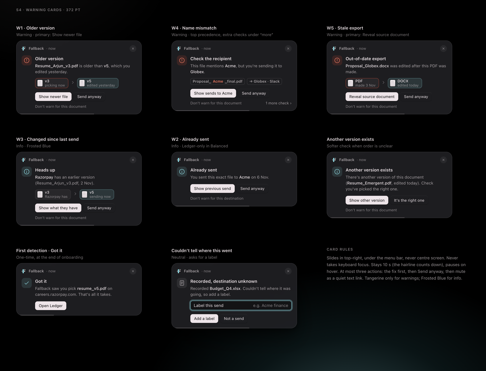
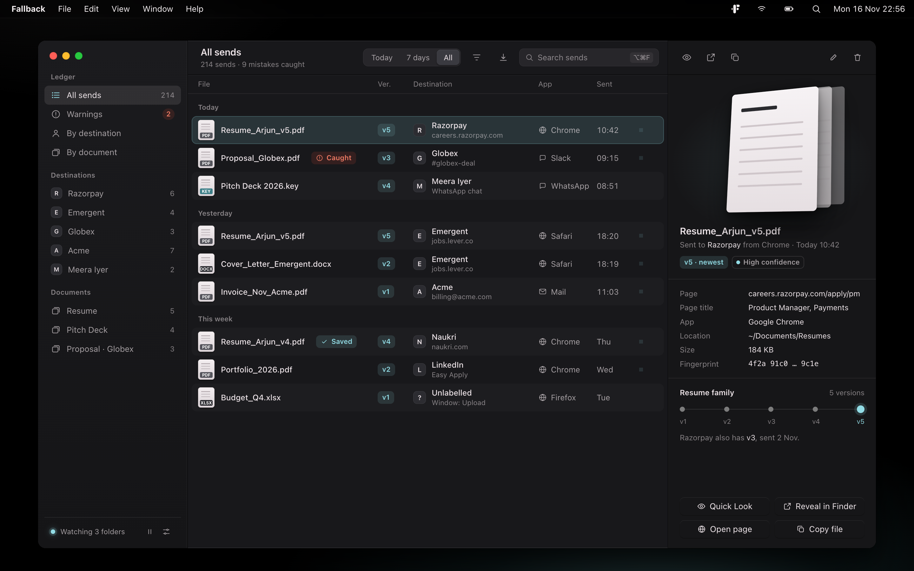

# Fallback

**Never send the wrong file again, and always know what you sent.**

Fallback is a small, free, open-source app for the Mac menu bar. It notices every file you attach or upload, keeps a private record of what went where, and taps you on the shoulder before the wrong version goes out.

## The problem

You keep several versions of the same document: `resume_v3.pdf`, `resume_v5_final.pdf`, `Proposal_Acme_revised.docx`. Sooner or later you:

- upload the **old version** of your resume to a job you really wanted,
- send a proposal with **another client's name** in the file name,
- send a PDF you exported **before** your last round of edits,
- or simply can't remember **which version** you sent to whom.

Fallback catches these at the moment you pick the file, and keeps a searchable list of everything you've sent.

## What it looks like

When something looks wrong, a small card slides in at the top right of your screen. It never blocks you: you can switch to the right file, send anyway, or ignore it.

The Ledger lists every file you've sent, where it went, and when:

*(These images are from the design. The app follows them closely.)*

## What it warns about

| Warning | When |
| --- | --- |
| **Older version** | A newer version of the same document exists on your Mac |
| **Check the recipient** | The file name mentions a different company from the one you're sending to |
| **Out-of-date export** | The PDF is older than the Word, Pages or Keynote file it came from |
| **Already sent** / **Changed since last send** | You sent this exact file, or a different version, to the same place before |

You choose how chatty it is in Settings › Warnings: Strict, Balanced or Quiet.

## The one permission it needs, and exactly what it reads

macOS calls it **Accessibility** (on newer versions, **Device Control and Data Access**). Fallback needs it to notice the "choose a file" window in other apps and see which file you picked. That's the only way an app can know a file was attached without you telling it.

With that permission, Fallback reads:

- **The file you pick**, in the file-choosing window of the apps it watches (browsers, Mail, Outlook, Slack, WhatsApp, Telegram, Teams, Discord and Zoom; you can switch any off). Picking a file in other apps, like Preview or Word, is ignored.
- **The title of that app's window**, to know roughly where the file is going.

It does **not** read what you type, what's on your screen, your emails or messages, or any other window.

Two more permissions are optional:

- **Your browser's current page address and title**, read once at the moment you upload, so the record says "Acme careers page" instead of just "Chrome". macOS asks once per browser.
- **The folders you choose** (Documents, Desktop and Downloads by default), so Fallback can tell versions of the same document apart. From each file it keeps the name, size, dates and a few fingerprints, never the contents. [SECURITY.md](SECURITY.md) has the full list.

## Everything stays on your Mac

- No account, no sign-in, no servers.
- Nothing is uploaded, ever. Fallback makes no network connections at all. A future update checker will be the only exception, and it can be switched off.
- No analytics, tracking or crash reporting.
- File contents are never stored: only names, dates, sizes and fingerprints.
- Settings › Privacy › **Delete All…** removes everything Fallback has recorded.

## Why there's no download yet

To hand out a Mac app as a download, the developer needs a paid Apple Developer membership. That lets Apple check and approve ("notarise") each release. Without it, macOS blocks the download, and each update looks like a brand-new app to macOS, so you'd have to grant the permission again after every update.

Building Fallback yourself avoids both problems. It's signed with **your own free Apple ID**, so macOS trusts it and **remembers its permission between updates**. A download will come later.

## Build it yourself in three steps

You don't need to know how to code. It takes about 15 minutes the first time, mostly waiting for downloads.

1. **Install Xcode and sign in.**
   - Install Xcode free from the Mac App Store. It's large, so give it time. Open it once and click **Agree** and **Install** if it asks.
   - Then choose **Xcode › Settings… › Accounts**, click **+**, choose **Apple ID** and sign in. A free Apple ID is enough.
2. **Install Homebrew**, a free helper for developer tools.
   - Go to [brew.sh](https://brew.sh) and copy the line under "Install Homebrew".
   - Open **Terminal** (Applications › Utilities), paste the line and press Return.
   - Type your Mac password when asked; nothing appears as you type, and that's normal.
3. **Download Fallback and double-click the build file.**
   - On this page, click the green **Code** button, then **Download ZIP**, and open the downloaded folder.
   - Double-click **Build Fallback.command**. It checks everything, builds Fallback, puts it in your Applications folder and starts it. If anything is missing, it stops and tells you what to do.
   - **The first time, macOS may say it can't verify the file.** That's because you downloaded it from the internet. Click **Done**, open **System Settings › Privacy & Security**, scroll down, click **Open Anyway** next to "Build Fallback.command", and confirm.

Fallback's icon appears in the menu bar, and a short setup walks you through the permission. To update later, download the new ZIP and double-click **Build Fallback.command** again.

## More

- [PRD.md](PRD.md): the full product spec (what Fallback does, and why).
- [Design/](Design/): the brand, colours, wording and every screen.
- [SECURITY.md](SECURITY.md): what Fallback reads and stores, and how to report a problem.
- Licence: [MIT](LICENSE).
